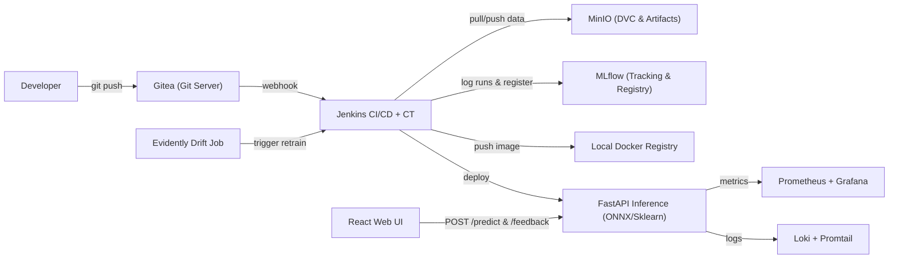

# ViSent — MLOps + Jenkins Local Practice

Dự án thực hành **End-to-End MLOps** cho bài toán phân tích cảm xúc tiếng Việt (**Vietnamese Sentiment Analysis - ViSent**), được thiết kế theo phương pháp **"Vừa học vừa làm"** qua 13 module tăng dần từ cơ bản đến hoàn chỉnh.

---

## Kiến trúc tổng thể (Sau 13 Module)



---

## Cấu trúc thư mục

```text
visent/
├── Makefile                    # Các lệnh chuẩn hoá (doctor, test, lint, train, up, down...)
├── scripts/
│   ├── doctor.py               # Kiểm tra môi trường (Docker, GPU, Python, Node, Git, WSL2)
│   └── wslconfig.example       # Mẫu cấu hình giới hạn RAM cho WSL2 (.wslconfig)
├── docs/
│   ├── roadmap.md              # Lộ trình chi tiết 13 module & bảng theo dõi tiến độ
│   ├── journal.md              # Nhật ký học tập, ghi chú lỗi & bài học sau mỗi module
│   ├── module-00-01-guide.md   # Hướng dẫn thực hành chi tiết Module 0 & Module 1
│   ├── architecture.md         # Tài liệu kiến trúc hệ thống (cập nhật dần)
│   └── runbook.md              # Cẩm nang xử lý sự cố (Module 11)
├── data/
│   ├── raw/                    # Dữ liệu gốc (theo dõi qua DVC từ Module 5)
│   └── processed/              # Dữ liệu đã tiền xử lý
├── ml/
│   └── src/
│       └── models/             # Code huấn luyện (TF-IDF + LR ở M1, PhoBERT ở M8)
├── backend/
│   └── api/                    # FastAPI serving (`/predict`, `/health`, `/metrics`)
├── frontend/                   # React + TypeScript UI & Nginx Gateway (từ Module 2)
├── tests/                      # Unit tests & API integration tests (pytest)
└── pipelines/                  # Jenkinsfile cho CI/CD, Training & Retraining
```

---

## Bắt đầu nhanh (Quick Start)

### 1. Kiểm tra sức khoẻ môi trường (Module 0)
Chạy bằng `uv` (vì Python trên máy bạn được quản lý qua `uv`) hoặc `make` (nếu trong WSL2/Git Bash):

```powershell
# Trên PowerShell (Windows)
uv run python scripts/doctor.py

# Hoặc nếu có GNU Make (WSL2 / Git Bash)
make doctor
```

### 2. Xem hướng dẫn thực hành ngay
- Đọc lộ trình tổng thể: [docs/roadmap.md](docs/roadmap.md)
- Thực hành ngay Module 0 & Module 1: [docs/module-00-01-guide.md](docs/module-00-01-guide.md)
- Ghi chép quá trình học: [docs/journal.md](docs/journal.md)
